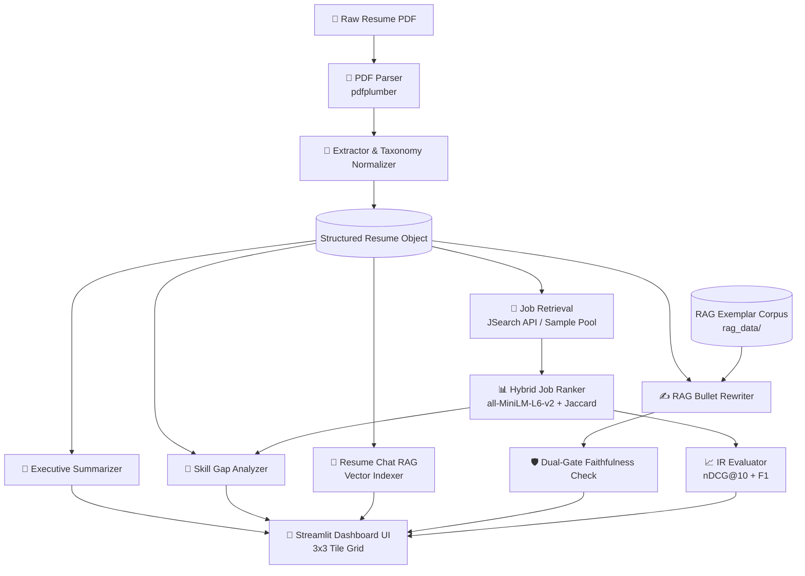

<div align="center">

# 🎯 ResumeIQ
### AI-Powered Resume Intelligence, RAG-Augmented Job Recommender & Career Copilot

[](https://www.python.org/)
[](https://streamlit.io/)
[](https://groq.com/)
[](https://huggingface.co/sentence-transformers/all-MiniLM-L6-v2)
[](https://docs.pytest.org/)
[](https://opensource.org/licenses/MIT)

<p align="center">
  <strong>Transform raw resumes into recruiter-optimized career assets with Dense Embeddings, RAG-Augmented Experience Rewriting, and LLM Reasoning.</strong>
</p>

</div>

---

## 📌 Overview

Over 75% of resumes are filtered out by Applicant Tracking Systems (ATS) before reaching human eyes. Candidates face persistent challenges in diagnosing skill deficiencies, targeting aligned openings, and phrasing daily responsibilities as quantified, high-impact achievements.

**ResumeIQ** is an end-to-end, multi-stage Artificial Intelligence application designed to bridge the gap between candidate qualifications and recruiter expectations. Built on a hybrid architecture combining **local bi-encoder dense embeddings** with **high-throughput cloud LLM inference (Groq / OpenAI)**, ResumeIQ audits resumes, surfaces aligned job openings, analyzes skill gaps, and enhances experience bullets with mathematically guarded faithfulness.

---

## ✨ Key Features

```
                                  RESUMEIQ DASHBOARD
  ┌─────────────────────────┬─────────────────────────┬─────────────────────────┐
  │   📊 Resume Analysis    │  🧠 AI Summary & Pitch  │ 🎯 AI Skill Gap Analysis│
  │     Score: 88 / 100     │   Elevator Pitch & Bio  │   50% Readiness & Plan  │
  ├─────────────────────────┼─────────────────────────┼─────────────────────────┤
  │ 💬 Chat with Resume RAG │    💼 Job Matches       │   ✍️ Bullet Rewriter    │
  │   Interactive Semantic  │    Multi-Criteria Fit   │   STAR Active Upgrades  │
  ├─────────────────────────┼─────────────────────────┼─────────────────────────┤
  │   🔬 Skills Deep-Dive   │  📈 Evaluation Metrics  │     🗂️ Raw JSON         │
  │   Taxonomy & Heatmap    │   nDCG@10 & Faithfulness│   Clean Schema Export   │
  └─────────────────────────┴─────────────────────────┴─────────────────────────┘
```

### 1. 📊 Intelligent Document Extraction & Health Audit
- Resilient PDF ingestion via `pdfplumber` handling noisy, multi-column, and non-standard formats.
- Pre-compiled regex NER parsing for contact links (Email, Phone, LinkedIn, GitHub).
- Rule-based **100+ technology taxonomy normalization** with synonym/alias resolution (e.g. `sklearn` → `scikit-learn`, `k8s` → `kubernetes`).
- 5-dimensional resume health scoring: section completeness, technical skill density, quantified metric frequency, word length, and passive bullet detection.

### 2. 🧠 AI Executive Summarizer & Elevator Pitch
- LLM-powered generation of a concise **30-second spoken Elevator Pitch**.
- Copy-paste ready **Executive Bio / Professional Summary** tailored for LinkedIn and resume headers.
- Top 3 career highlight bullet points with strong action verbs.
- Dynamic **Role Refocusing**: Regenerate the summary toward any target job title or industry on demand.

### 3. 🎯 AI-Powered Skill Gap Analysis
- Computes an objective **Target Role Readiness Score** (0–100%) against target job descriptions.
- Prioritizes missing competencies into **Critical**, **Important**, and **Nice-to-Have**.
- Generates an LLM-driven **Strategic Assessment** and a practical **4-Week Skill Bridge Plan**.
- Direct curated learning resources and search shortcuts for every missing technology.

### 4. 💬 Conversational Resume Chat (RAG Q&A Engine)
- In-memory vector indexing of candidate resume chunks (roles, bullets, education, projects, skills) via `all-MiniLM-L6-v2`.
- Semantic cosine retrieval (`top_k=4`) grounding every response in verifiable candidate data.
- Interactive multi-turn chat UI with pre-set quick prompt chips (*Top AI Strengths*, *Senior Gaps*, *Role Summaries*, *Project Highlights*).
- Transparent source citation expanders showing the exact resume snippets informing each answer.

### 5. 💼 Multi-Criteria Hybrid Job Ranker
- Hybrid scoring formula:
  $$\text{Match Score} = w_{\text{sem}} \cdot S_{\text{semantic}} + w_{\text{skill}} \cdot S_{\text{skill}} + w_{\text{sen}} \cdot S_{\text{seniority}}$$
  - **Dense Semantic Similarity ($55\%$)**: Cosine similarity between resume embeddings and job descriptions.
  - **Skill Overlap ($35\%$)**: Jaccard-style token overlap against normalized job requirements.
  - **Seniority Fit ($10\%$)**: Experience heuristic based on parsed career timeline and target job title.
- Natural language **LLM Match Justifications** for top-ranked jobs explaining fit and gap areas.
- Automated API discovery via **OpenWebNinja / JSearch API** with disk caching and client credit rate-limiting.

### 6. ✍️ RAG-Augmented Experience Bullet Rewriter
- Detects passive, weak openings (`"worked on"`, `"helped with"`, `"responsible for"`).
- Dynamic vector retrieval of top-3 exemplar bullet achievements from an internal corpus (`rag_data/`).
- Generates quantified, active accomplishments following the **Google XYZ formula** (*"Accomplished [X], measured by [Y], by doing [Z]"*).
- **Dual-Gate Faithfulness Verification**: Combines named entity/keyword preservation with semantic embedding similarity to mathematically prevent LLM hallucination.
- **Smart Action Engine**: Automatic offline heuristic fallback if LLM API quotas are exhausted.

### 7. 📈 Evaluation & IR Metrics Suite
- **Relevance-Grounded nDCG@10**: Evaluates hybrid ranking quality against an independent qualification benchmark (skill coverage + domain alignment + seniority fit) rather than trivial self-comparison.
- **Extraction F1 Evaluator**: Precision, Recall, and F1 calculation against user-provided ground-truth skill lists.
- **Aggregate Faithfulness Tracking**: Continuous auditing of rewrite fidelity across snapshots.
- **Historical Snapshots**: Persistent JSON snapshots for regression tracking across iterations.

### 8. 🧭 Zero-Scroll 3×3 Navigation Tile Matrix
- Replaces cramped horizontal scrolling tabs with a modern **3×3 Dashboard Matrix**.
- Real-time status badges on every tile (`Score 88/100`, `nDCG 0.989`, `50% Match`, etc.).
- Responsive, 1-click view switching with active gradient illumination.

---

## 🏗️ System Architecture



---

## 🛠️ Tech Stack

| Domain | Technologies & Libraries |
| :--- | :--- |
| **Frontend & UI** | [Streamlit](https://streamlit.io/), Custom Vanilla CSS (Glassmorphism, Inter Typography, Dynamic Tiles) |
| **Generative LLM** | [Groq LPU](https://groq.com/) (`qwen/qwen3.8-27b`, `llama-3.3-70b-versatile`), [OpenAI API](https://openai.com/) (`gpt-4o-mini`) |
| **Embeddings & NLP** | [Sentence Transformers](https://www.sbert.net/) (`all-MiniLM-L6-v2`), PyTorch, SciPy |
| **Document Processing** | [pdfplumber](https://github.com/jsvine/pdfplumber), Regular Expressions (NER & Normalization) |
| **Data & Retrieval** | [Pandas](https://pandas.pydata.org/), [NumPy](https://numpy.org/), Requests, OpenWebNinja JSearch API |
| **Testing & Quality** | [Pytest](https://docs.pytest.org/) (25 Unit & Integration Tests) |

---

## 🚀 Quickstart Guide

### 1. Prerequisites
- Python 3.10, 3.11, or 3.12
- Git

### 2. Clone Repository
```bash
git clone https://github.com/your-username/ResumeIQ.git
cd ResumeIQ
```

### 3. Create & Activate Virtual Environment
```bash
# Windows
python -m venv venv
venv\Scripts\activate

# macOS / Linux
python3 -m venv venv
source venv/bin/activate
```

### 4. Install Dependencies
```bash
pip install -r requirements.txt
```

### 5. Configure Environment Variables
Copy `.env.example` to `.env`:
```bash
cp .env.example .env
```

Open `.env` and set your preferred provider keys:
```env
# Choose: "groq" (recommended for free high-speed inference) or "openai"
LLM_PROVIDER=groq
LLM_MODEL=qwen/qwen3.8-27b
GROQ_API_KEY=your_groq_api_key_here

# Optional: JSearch API for live job discovery
JSEARCH_API_KEY=your_key_here
```
> **Note:** If no API key is provided, ResumeIQ automatically uses its built-in **Smart Action Engine** and sample candidate pools, ensuring full functionality without external API dependencies.

### 6. Launch Application
```bash
streamlit run app.py
```
Open **http://localhost:8501** in your browser.

---

## 🧪 Testing & Verification

The project includes automated test suites covering extraction correctness, skill normalization, weak bullet detection, ranking nDCG, and the GenAI modules (RAG chat, summarizer, gap analyzer).

Run the full test suite:
```bash
python -m pytest test_extraction.py test_genai_features.py -v
```

Expected output:
```
test_extraction.py::TestSkillNormalization::test_alias_resolution PASSED
test_extraction.py::TestSkillNormalization::test_case_insensitive PASSED
test_extraction.py::TestWeakBulletDetection::test_bullet_weakness PASSED
test_extraction.py::TestNDCG::test_perfect_ordering PASSED
test_extraction.py::TestExtractionF1::test_perfect_match PASSED
test_genai_features.py::TestResumeSummary::test_summary_generation PASSED
test_genai_features.py::TestGapAnalyzer::test_skill_gap_analysis PASSED
test_genai_features.py::TestResumeRAGChat::test_chat_indexing_and_answer PASSED

======================== 25 passed in ~1 min ========================
```

---

## 📁 Repository Structure

```
├── app.py                   # Main Streamlit application with 3x3 Tile Matrix UI
├── config.py                # Central constants, scoring weights, paths & taxonomy
├── extractor.py             # Rule-based NER, skill normalization & health scoring
├── gap_analyzer.py          # AI skill gap analyzer & 4-week roadmap generator
├── resume_chat.py           # Conversational RAG engine over candidate resume
├── rewriter.py              # RAG bullet rewriter, faithfulness check & executive summary
├── ranker.py                # Multi-criteria hybrid job ranker (embeddings + overlap)
├── evaluator.py             # Ground-truth nDCG@K, Extraction F1 & snapshot persistence
├── jsearch_client.py        # OpenWebNinja / RapidAPI JSearch client with disk cache
├── llm_client.py            # Unified LLM client adapter (Groq & OpenAI)
├── pdf_parser.py            # Multi-column resilient PDF text extractor
├── logger.py                # Rotating structured logger
├── requirements.txt         # Production & development dependencies
├── .env.example             # Template for API keys & model configuration
├── .gitignore               # Strict exclusion of keys, caches, logs & personal PDFs
├── LICENSE                  # MIT License
│
├── rag_data/                # Domain-specific exemplar bullet knowledge base
│   ├── ml_ai_bullets.json
│   ├── software_engineering.json
│   ├── data_engineering.json
│   └── cloud_devops.json
│
├── snapshots/               # Persisted evaluation snapshots (*.json)
├── test_resumes/            # Sample PDF resumes for automated benchmarking
├── test_extraction.py       # Unit tests for parser, NER, ranking & F1
└── test_genai_features.py   # Unit tests for summarizer, gap analysis & RAG chat
```

---

## 📊 Evaluation & Mathematical Rigor

### 1. Multi-Criteria Hybrid Score
$$\text{Score}(R, J) = \left( 0.55 \cdot \cos(\mathbf{e}_R, \mathbf{e}_J) + 0.35 \cdot \frac{|S_R \cap S_J|}{|S_J|} + 0.10 \cdot \text{Fit}_{\text{seniority}} \right) \times 100$$

### 2. Dual-Metric Rewrite Faithfulness Gate
$$\text{Faithfulness}(B_{\text{orig}}, B_{\text{new}}) = 0.50 \cdot \frac{|K_{\text{orig}} \cap K_{\text{new}}|}{|K_{\text{orig}}|} + 0.50 \cdot \cos(\mathbf{e}_{\text{orig}}, \mathbf{e}_{\text{new}})$$

### 3. Relevance-Grounded nDCG@10
$$\text{DCG}@K = \sum_{i=1}^K \frac{2^{y_i/100} - 1}{\log_2(i + 1)}, \quad \text{nDCG}@K = \frac{\text{DCG}@K}{\text{IDCG}@K}$$
*Ground-truth relevance $y_i$ is computed independently from candidate qualification fulfillment rather than circular rank self-comparison.*

---

## 🛡️ Security & Privacy

- **Zero Secret Commits**: The repository enforces strict `.gitignore` rules preventing `.env`, log files, runtime caches, and personal PDF resumes from being tracked.
- **Client-Side Privacy**: Dense sentence embeddings run locally via PyTorch; resume text is never transmitted to external third-party vectors or external storage.

---

## 📜 License

Distributed under the **MIT License**. See [`LICENSE`](LICENSE) for more information.

---

<div align="center">
  <sub>Developed with ❤️ for job seekers, recruiters, and AI researchers.</sub>
</div>
